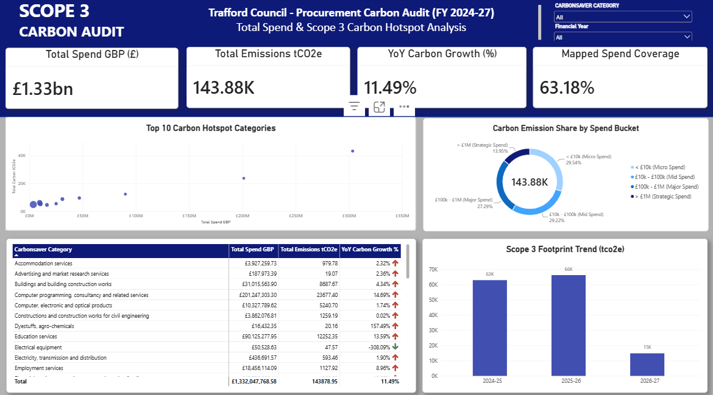

# Trafford Council Scope 3 Procurement Carbon Audit (FY 2024–27)

## 📌 Executive Summary

This end-to-end data analytics project delivers an executive-grade Scope 3 Greenhouse Gas (GHG) Carbon Audit for Trafford Council, evaluating £1.33 Billion in procurement spend across ~509,000 transaction records spanning Financial Years 2024 through 2027.

Using a spend-based environmentally extended input-output (EEIO) conversion methodology mapped to DEFRA and CarbonSaver greenhouse gas factors, the analysis quantifies Trafford's indirect supply chain emissions (143.88k tCO2e), identifies high-impact procurement hotspots, and provides actionable recommendations to halt a +11.49% YoY carbon growth trend.

## 🔑 Key Strategic Insights

### 1. Category Hotspots (Outliers):

- Residential Care Services and Computer Programming & IT Consultancy Services represent the council's largest carbon intensity drivers per pound spent.

- IT Consultancy alone accounts for £201.2M in spend and 23.68k tCO2e (+14.69% YoY carbon growth).

### 2. The "Micro-Spend" Carbon Trap:

- 58.76% of total carbon emissions ($29.54\% + 29.22\%$) originate from Micro Spend (< £10k) and Mid Spend (£10k–£100k) purchase orders.

- Strategic contracts exceeding > £1M account for only 13.95% of total emissions, demonstrating that sustainability policies must target operational purchasing thresholds rather than flagship contracts alone.

### 3. Data Coverage & Audit Integrity:

- 63.18% of total audited spend is successfully mapped to standardized carbon conversion categories, providing a statistically sound foundation for strategic procurement interventions.

## 🛠️ Tech Stack & Architecture
  
- **Database Engine**: PostgreSQL 15+ (Relational storage, schema design, analytical queries via pgAdmin 4 / VS Code)

- **Data Ingestion & ETL**: Python (pandas, SQLAlchemy, psycopg2 for bulk cleaning, transformation, and database loading)

- **Analytics & Visualization**: Power BI Desktop (DAX data modeling, dynamic visual analytics, and carbon intensity metrics)

- **Version Control & Documentation**: Git & GitHub (Repository management, SQL script tracking, and README documentation)

## 💻 Data Pipeline & Technical Implementation

### 1. Database Schema & Data Ingestion (Python & SQL)

Raw multi-year procurement spend datasets were processed, cleansed, and bulk-ingested into a PostgreSQL database named Trafford_Scope3_db:

- [Data cleaning and bulk-ingestion script](01_ingest_data.py)

### 2. SQL Data Transformation & Carbon Calculation

Custom SQL queries were authored to aggregate spend, compute carbon conversion factors ($tCO2e = Spend \times IntensityFactor$), and rank top emissions drivers using window functions:

- [Ranking Categories by Carbon Intensity](02_carbon_intensity_analysis.sql)

- [Supplier Concentration and Pareto Analysis](03_pareto_supplier_analysis.sql)

- [Data Governance and Unmapped Tail Spend Audit](04_data_governance_audit.sql)

- [YoY Growth and Percentage variance](05_yoy_trend_analysis.sql)

### 3. DAX Data Modeling in Power BI

Key DAX measures and calculated columns were built to power the dashboard metrics:

- Custom Spend Bucket Classification (Calculated Column)

- Mapped Spend Coverage Share (%)

## 📊 Dashboard Overview & Features

The executive dashboard is designed using a high-contrast Navy & White visual hierarchy for immediate board readability:

- **Top Banner KPIs**: Instant high-level summary (Total Spend, Total Emissions tCO2e, YoY Growth %, and Mapped Spend Coverage %).

- **Scatter Plot** (Top 10 Carbon Hotspot Categories): Maps spend (£) against tCO2e emissions to immediately isolate extreme intensity outliers like Residential Care and IT Services.

- **Donut Chart** (Emissions Share by Spend Bucket): Displays the strategic breakdown of carbon emissions across contract sizes.

- **Summary Matrix Table**: Provides full audit traceability down to specific category spend, total emissions, and YoY percentage changes with visual growth indicators.

- **Multi-Year Trend Analysis**: Historical column visual capturing the emissions trajectory across FY 2024–25, FY 2025–26, and FY 2026–27.

## 🎯 Recommendations for Decarbonization

- **Targeted Supplier Engagement**: Initiate mandatory decarbonization plans for suppliers operating in Residential Care and Computer Programming / IT Consultancy.

- **Procurement Policy Reform**: Establish green purchasing compliance guidelines for orders under £100k, addressing the 58% footprint concentration across micro and mid-level purchasing.

- **Data Quality Enhancement**: Refine unclassified spend entries to increase mapped coverage beyond 63.18% in subsequent reporting cycles.

## 📝 Conclusion

This project successfully bridges the gap between raw financial spend records and strategic carbon management. By combining robust PostgreSQL data warehousing, automated Python ETL pipelines, and executive Power BI visualization, Trafford Council is equipped with data-driven clarity to target high-intensity supply chain hotspots. Beyond audit compliance, these insights provide a clear strategic roadmap to enforce sustainable procurement policies, optimize council spending, and achieve long-term net-zero carbon reduction targets.

## 📊 Data Source
- The dataset "Trafford_Supplier_Spend_metadata" was sourced from the National Data Library, published by Trafford Council, updated 25th August, 2026 (https://www.data.gov.uk/dataset/e32c1ade-5608-4952-b36c-58e5b73eba2a/expenditure-exceeding-500-gbp-supplier-spend).

- Carbonsaver category and Carbon factor Mapping was done via DEFRA GHG Footprint Reporting Methodology platform updated 14th May, 2025(https://carbonsaver.org/tools/scope_3_CO2e_factors.php)